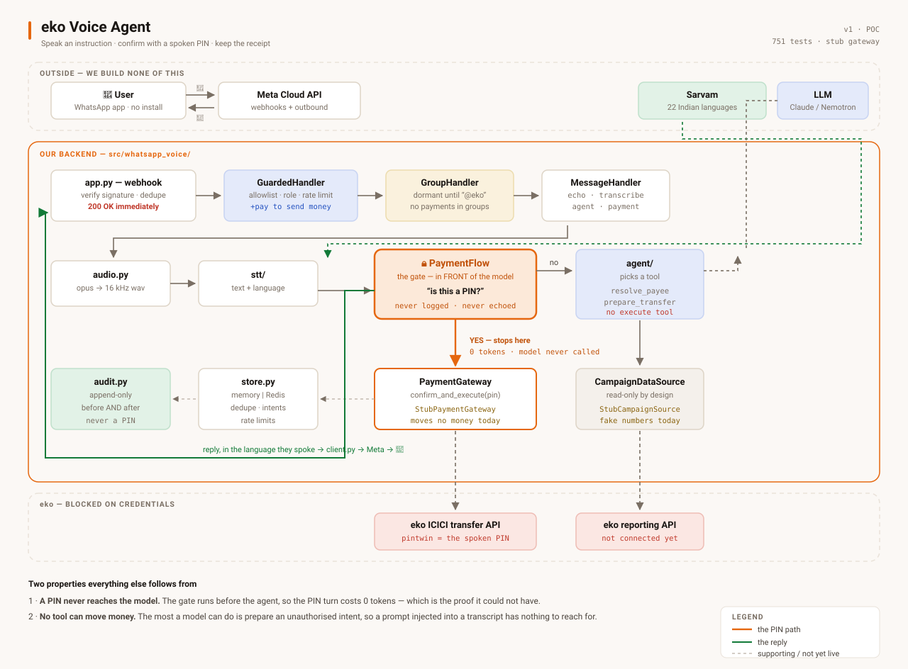
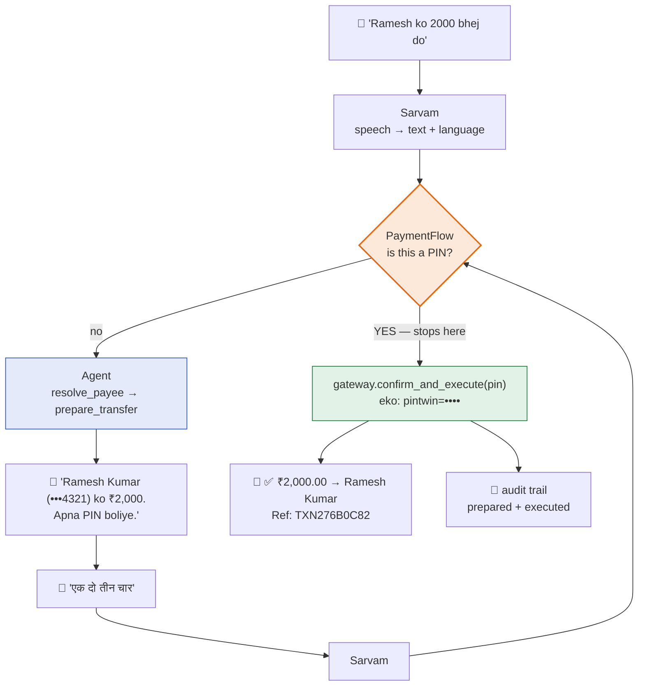

# eko Voice Agent

Send a voice note to a WhatsApp Business number. Ask a question and get an answer;
say a payment instruction and confirm it with a spoken PIN.

```
"aaj kitne campaign gaye?"   →  "Aaj 12 campaigns gaye. 8 delivered, 3 pending, 1 failed."

"Ramesh ko 2000 bhej do"     →  "Ramesh Kumar (•••4321) ko ₹2,000. Apna PIN boliye."
"एक दो तीन चार"               →  "✅ ₹2,000.00 → Ramesh Kumar · Ref: TXN276B0C82"
```

Speech is Sarvam (22 Indian languages, auto-detected; the reply comes back in the
language you spoke). The agent is Claude or Nemotron, selected by config.

**Status:** 751 tests, ruff clean. Everything below runs today against stub data
and a stub payment gateway.

Three things are **not** done, and none of them is code:

| Blocked on | What is unverified |
|---|---|
| Meta credentials | The WhatsApp round trip has never run. Everything else is exercised through the demo API. |
| eko API credentials | `EKO_DEVELOPER_KEY` / `EKO_AUTH_KEY`, plus the `EKO_REPORT_*` codes that select a report. Both the gateway and the reporting source are written and tested against mocks, never a sandbox. |
| Compliance sign-off | `PAYMENT_GATEWAY` stays `stub`. A spoken PIN is not a valid second factor under the RBI directions effective 1 April 2026. |

Until then the agent answers with **fake numbers** and **moves no money** — every
receipt says `TEST MODE`, and `/health` reports `real_money: false`.

---

## What it does



The payment path on its own:



**The gate sits in front of the model, not behind it.** A PIN never reaches the
LLM, the conversation history, or the logs — the PIN turn costs **0 tokens**,
which is the proof it could not have.

**There is no `execute_transfer` tool.** The most a model can do is
`prepare_transfer`, which returns an unauthorised intent. That is what makes a
prompt injected into a transcript unable to move money.

Full reasoning: **[docs/voice-payments.md](docs/voice-payments.md)**.

---

## Commands

Every command below is runnable as written, from the repo root. The venv is
**Python 3.11** — always `.venv/bin/python`, never a bare `python`.

### Setup

```bash
python3.11 -m venv .venv
.venv/bin/pip install -e ".[stt,server,agent,dev]"
cp .env.example .env
```

### Tests and lint — no credentials needed

```bash
.venv/bin/python -m pytest                      # all 751
.venv/bin/python -m pytest tests/test_payments.py
.venv/bin/python -m pytest tests/test_payments.py::TestNoExecutePath
.venv/bin/python -m pytest -q                   # quiet
.venv/bin/ruff check .
.venv/bin/ruff check --fix .
```

### Run it locally

```bash
# 1. the backend  (reads HANDLER from .env)
.venv/bin/python tools/run_server.py
.venv/bin/python tools/run_server.py --reload   # auto-restart while editing

# 2. the demo UI  (needs DEMO_ENABLED=true)
cd frontend && npm install && npm run dev       # → http://localhost:5173
```

Health and status, once the server is up:

```bash
curl -s localhost:8000/health | python3 -m json.tool
curl -s localhost:8000/demo/status | python3 -m json.tool
```

### Drive it without WhatsApp

```bash
# ask something
curl -s -X POST localhost:8000/demo/ask -H 'Content-Type: application/json' \
  -d '{"question":"Ramesh ko 2000 bhej do","session_id":"t1"}'

# confirm with a PIN  (0 tokens — the model is not called)
curl -s -X POST localhost:8000/demo/ask -H 'Content-Type: application/json' \
  -d '{"question":"1234","session_id":"t1"}'

# share a contact, so no digit read-back is needed
curl -s -X POST localhost:8000/demo/contact -H 'Content-Type: application/json' \
  -d '{"phone":"9111222333","name":"Naya Aadmi","session_id":"t1"}'

# send real audio through the whole pipeline
curl -s -X POST localhost:8000/demo/voice \
  -F "audio=@data/audio/hi_1.wav" -F "session_id=t1"

# mission control — status + audit
curl -s "localhost:8000/demo/audit?limit=10" | python3 -m json.tool
```

### Connect to real WhatsApp

```bash
.venv/bin/python tools/run_server.py            # terminal 1
.venv/bin/python tools/start_tunnel.py          # terminal 2 → prints the public URL
```

`start_tunnel.py` performs Meta's verification handshake itself before printing
anything to paste into the dashboard, and warns about whatever is still unset.
Then in `.env`: `AUTH_ENABLED=true` and
`WHATSAPP_ALLOWED_NUMBERS=<your number>:admin+pay`.

```bash
.venv/bin/python tools/send_hello.py 91XXXXXXXXXX   # prove outbound works first
```

### Other operator scripts

```bash
.venv/bin/python tools/benchmark_stt.py         # compare STT engines on data/audio/
WHISPER_MODEL=tiny .venv/bin/python tools/benchmark_stt.py   # env vars override .env
```

### Container

```bash
docker build -t eko-voice .
docker run --rm -p 8000:8000 --env-file .env eko-voice
```

---

## Configuration

`HANDLER` in `.env` decides what the bot does:

| `HANDLER` | Behaviour |
|---|---|
| `echo` | Replies with what it understood. Proves the round trip. |
| `transcribe` | Voice note in, transcript out. |
| `agent` | Voice note in, answered from campaign data. |
| `payment` | The above, plus voice-initiated transfers. Needs `PAYMENTS_ENABLED=true`. |

The switches that matter most:

```bash
HANDLER=payment
PAYMENTS_ENABLED=true       # separate on purpose — money needs opting in
PAYMENT_GATEWAY=stub        # 'eko' moves real money; leave it alone
PAYMENT_AUDIT_PATH=data/audit/payments.jsonl
SARVAM_LANG=unknown         # auto-detect, so a Tamil speaker gets Tamil back
AUTH_ENABLED=true
WHATSAPP_ALLOWED_NUMBERS=919876543210:admin+pay
GROUPS_ENABLED=false        # needs an Official Business Account
WEB_CONCURRENCY=1           # more than one worker requires REDIS_URL
```

Every setting is documented in [`.env.example`](.env.example) with the reasoning.

---

## Layout

| Path | What |
|---|---|
| `src/whatsapp_voice/` | The package. Anything two phases share lives here. |
| `src/whatsapp_voice/stt/` | Speech engines behind one `Transcriber` interface |
| `src/whatsapp_voice/whatsapp/` | Cloud API client, webhook server, swappable `MessageHandler` |
| `src/whatsapp_voice/agent/` | LLM agent, tools, and the `CampaignDataSource` / `PaymentGateway` boundaries |
| `src/whatsapp_voice/auth/` | Allowlist, roles, the `+pay` capability, rate limiting |
| `src/whatsapp_voice/audit.py` | Append-only record of every attempt to move money |
| `src/whatsapp_voice/store.py` | Shared state, so more than one worker is safe |
| `src/whatsapp_voice/agent/handoff.py` | Authorising in the payer's own app — the production alternative to a spoken PIN |
| `frontend/` | React demo UI. Not the product — see [DESIGN.md](frontend/DESIGN.md). |
| `tools/` | Operator scripts. May import `src/`; never the reverse. |
| `docs/` | Plan, architecture, per-phase runbooks |
| `data/` | Gitignored — audio, transcripts, the audit trail |

---

## Documentation

- **[Architecture](docs/ARCHITECTURE.md)** — how the pieces fit, every diagram, file-by-file map, where new code goes
- **[Meta integration runbook](docs/meta-integration-runbook.md)** — **read this before touching the Meta dashboard.** Tokens, webhooks, and every failure this integration has produced, each with its fix
- **[Voice payments](docs/voice-payments.md)** — the PIN gate, amount parsing, every safety limit, the eko contract
- **[Implementation plan](docs/IMPLEMENTATION_PLAN.md)** — status, phases, risks, decision log
- **[Demo UI](docs/demo-ui.md)** — presenting the system without Meta credentials
- **[Design](frontend/DESIGN.md)** — Eko Factory design language, and why the chat column keeps WhatsApp's colours
- **[Skill: recipes](.claude/skills/whatsapp-voice-agent/SKILL.md)** — step-by-step for common changes and debugging playbooks

| Phase | Runbook | Covers |
|---|---|---|
| 0 | [STT benchmark](docs/phase-0-stt-benchmark.md) | What audio to record, how to read results |
| 1 | [Meta setup](docs/phase-1-meta-setup.md) | Getting Cloud API credentials |
| 2 | [Webhook server](docs/phase-2-webhook.md) | Tunnel, Meta webhook config, echo test |
| 3 | [Voice pipeline](docs/phase-3-voice.md) | Voice note in, transcript out |
| 4 | [The agent](docs/phase-4-agent.md) | Model choice, tools, plugging in the real API |
| 5 | [Authorisation](docs/phase-5-auth.md) | Threat model, allowlist, rate limits |
| 6 | [Deployment](docs/phase-6-deploy.md) | Container, hosting, worker count |

---

## Working agreement

- One branch per unit of work, merged to `main` with `--no-ff`
- A branch merges only when its tests pass and lint is clean
- `main` always works
- Confirm before starting a new phase
- **Keep this file and [ARCHITECTURE.md](docs/ARCHITECTURE.md) current.** A diagram
  that no longer matches the code is worse than no diagram — someone will trust it.

## A note on data

`data/` is gitignored because voice notes, transcripts and the audit trail contain
real customer data. The audit trail records full phone numbers deliberately (a
trail whose subject cannot be identified is not one), which makes it personal data
under DPDP: encrypted storage, stated retention. Keep it out of git.
