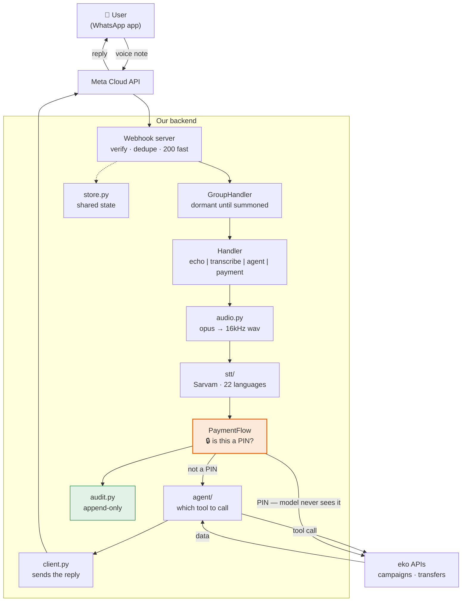
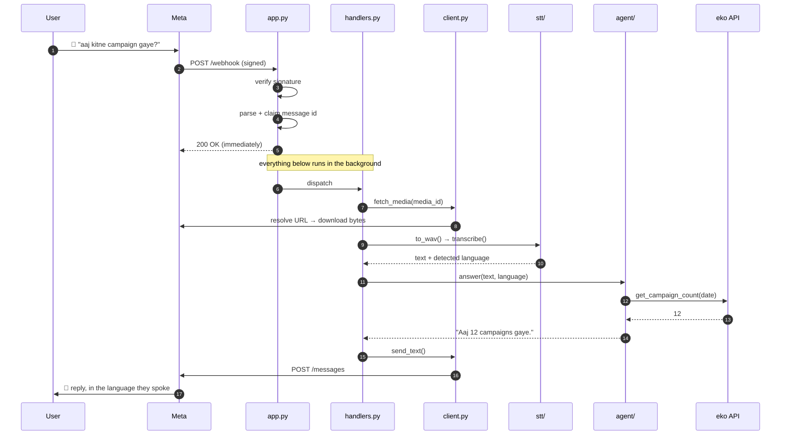
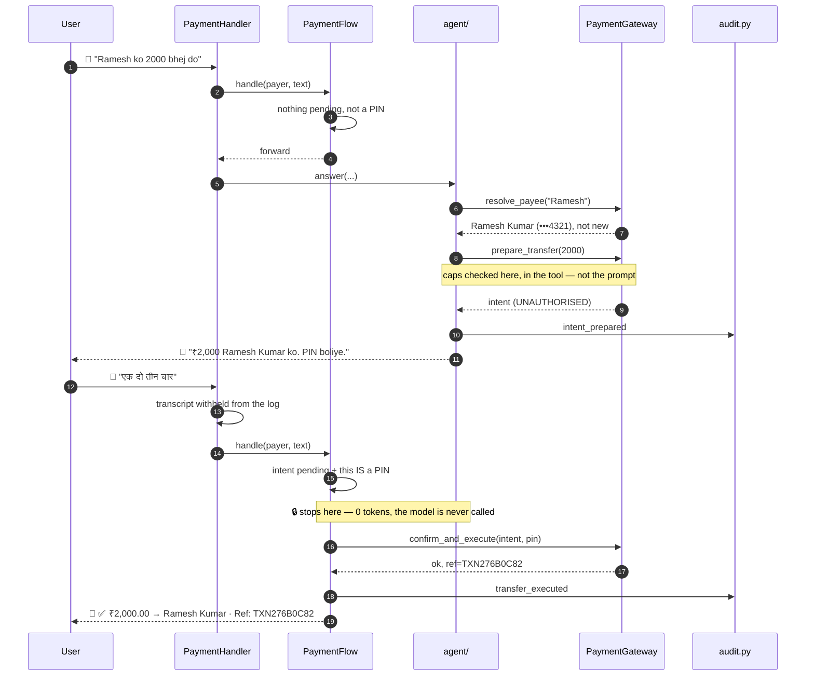
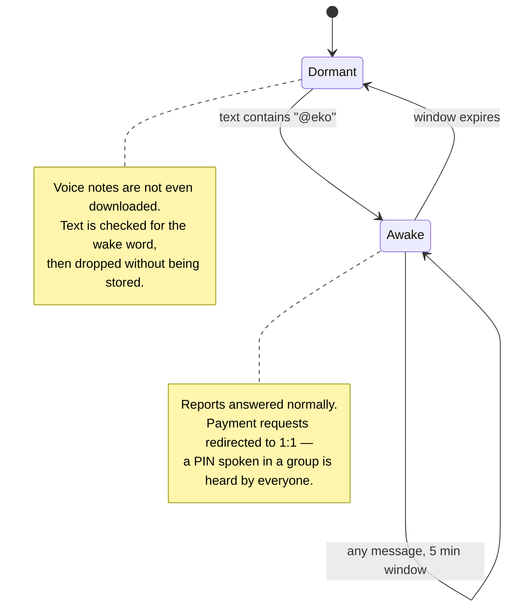
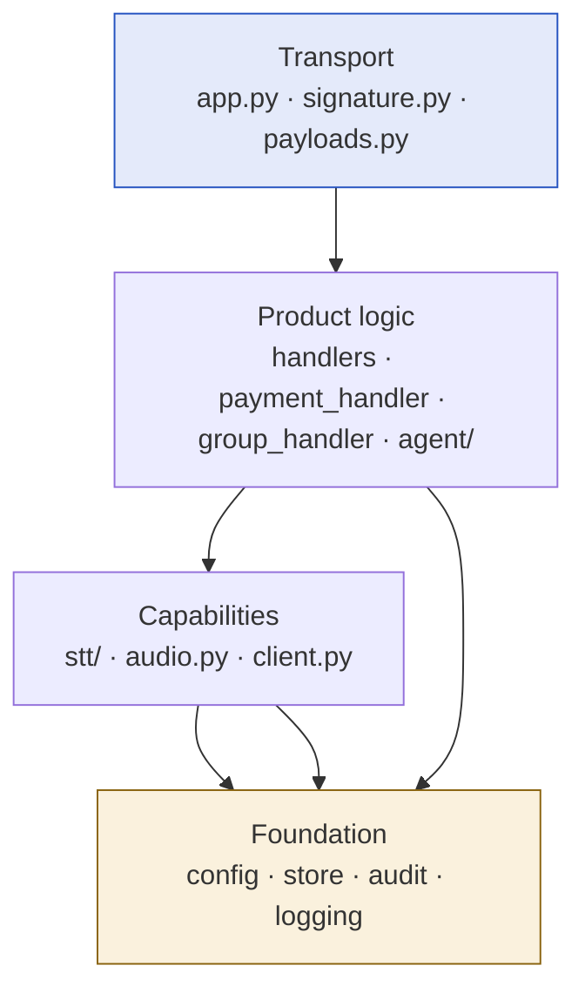
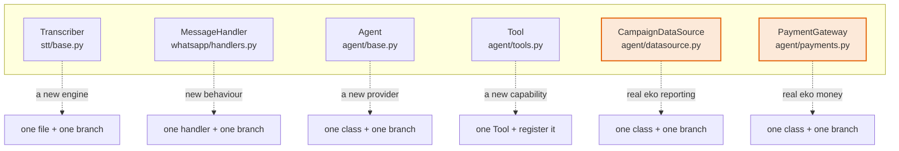
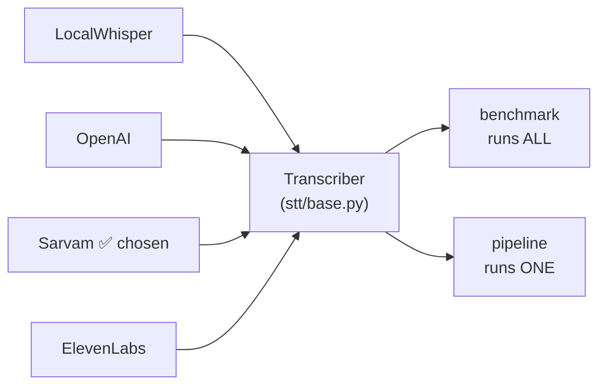
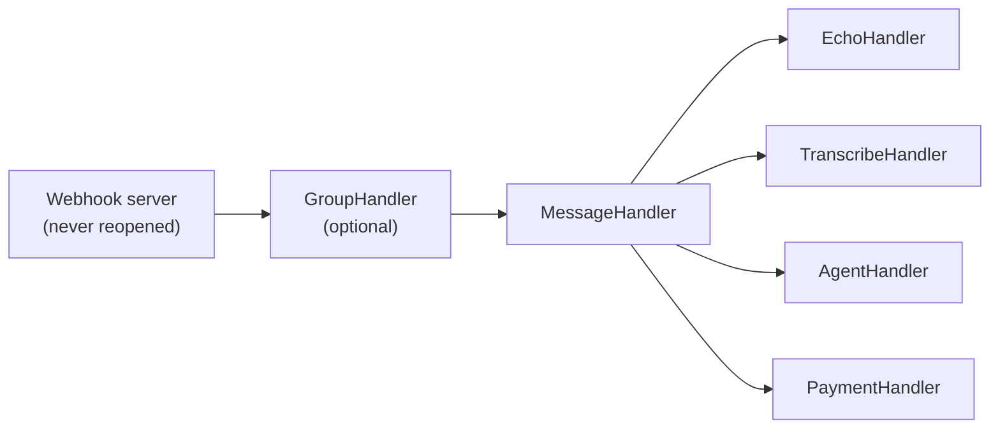
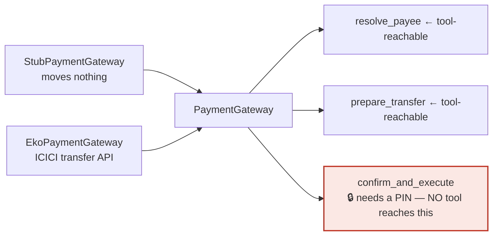
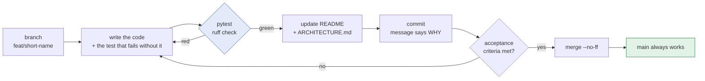

# Architecture

How this system is put together, and the rules for adding to it.

Read this before writing code here. The [implementation plan](IMPLEMENTATION_PLAN.md)
says *what* we are building and in what order; this document says *how the pieces
fit* and *where new code goes*.

---

## 1. The system in one picture


The same thing as a diagram you can edit, for anyone reading this on a renderer
that does not do SVG:



Two things in that picture carry most of the design.

**`PaymentFlow` is in front of the agent, not behind it.** A message that turns
out to be a PIN is consumed before the model, the conversation history or the log
can touch it. Everything in [voice-payments.md](voice-payments.md) follows from
that placement.

**There is no access guard.** `build_handler` returns the configured handler
directly (wrapped only in `GroupHandler` when groups are enabled) — every
number that reaches this server is answered, payments included. An earlier
allowlist/role/`+pay` system (`GuardedHandler`) was removed deliberately; see
[phase-5-auth.md](phase-5-auth.md).

### There is no frontend — and that is the point

WhatsApp **is** the user interface. We do not build, style, or deploy any screen the
user sees; Meta's app does that. Everything in `src/` is backend.

That is a feature, not a gap: no app to install, no login screen, no design system,
no App Store review. The user already has WhatsApp open.

> **`frontend/` exists — it does not contradict this.** It is a React *demo* app for
> showing the system to people before Meta credentials are in place, plus a
> demo-only HTTP API under `/demo` that it calls. Nothing in `src/` depends on it,
> it is not deployed with the product, and deleting it would leave the system
> unaffected. It follows the separation described in [§7](#7-if-a-frontend-is-ever-added).
> See [demo-ui.md](demo-ui.md).

If a **product dashboard** is ever wanted (viewing conversations, transcripts,
costs), that is a third thing again — a real application with real users, which is
what §7 is actually about.

---

## 2. What happens when someone sends a voice note

### 2a. A question



**The 200 goes out before any real work starts.** Meta retries anything that is
not a prompt 200, so a slow reply turns one voice note into a pile of duplicates.
Transcription takes seconds; far too long to hold a webhook connection.

### 2b. A payment

The same front half, and then a gate the question path never meets.



Three properties worth naming, because each is enforced somewhere specific:

| Property | Enforced by |
|---|---|
| A PIN never reaches the model | `PaymentFlow.handle` runs before `agent.answer` |
| A PIN never reaches the log | `PaymentHandler._log_transcript` withholds it for the whole pending window — the check is on the *window*, not the content |
| No tool can move money | `payment_tools.py` exposes two tools, neither of which executes; `confirm_and_execute` needs a PIN, which only the handler has |

### 2c. A group



## 3. Layers

Four layers, each depending only on the ones below it. Nothing ever depends upward.

| Layer | Files | Responsibility | Changes when… |
|---|---|---|---|
| **Transport** | `whatsapp/app.py`, `signature.py`, `payloads.py` | Receive from Meta, prove it is genuine, turn JSON into typed objects | Meta changes their API (rare) |
| **Product logic** | `whatsapp/handlers.py`, `payment_handler.py`, `group_handler.py`, `agent/` | Decide what to *do* with a message | **Every phase** |
| **Capabilities** | `stt/`, `audio.py`, `whatsapp/client.py` | Reusable skills: transcribe, convert audio, send messages | New engine or new API call |
| **Foundation** | `config.py`, `store.py`, `audit.py`, `metrics.py`, `logging_setup.py` | Settings, shared state, evidence, measurement | New configuration |

The value of the split: **the transport layer is written once and never touched
again.** Every phase since has added product logic without reopening `app.py`.



Arrows point the only direction a dependency may go. `agent/` importing from
`whatsapp/` would be a layering violation; `whatsapp/` importing from `agent/` is
how it is meant to work.

---

## 4. File map

Every file, what it does, and why it is its own file.

### `src/whatsapp_voice/` — the package

Anything two phases both need lives here. This is importable, testable code with no
side effects at import time.

| File | Does | Why separate |
|---|---|---|
| `config.py` | All settings, read from `.env` into typed dataclasses | One place to see everything the system needs to run. No `os.environ` scattered through the codebase |
| `audio.py` | opus/m4a → 16kHz mono WAV, duration, file discovery | Both the benchmark and the live pipeline need identical conversion |
| `metrics.py` | Word error rate, text normalisation | Pure functions, no I/O — trivially testable |
| `audit.py` | Append-only record of every attempt to move money | A log answers "what happened"; this answers "and can you prove it". Different rules — see [voice-payments.md](voice-payments.md) |
| `store.py` | `KeyValueStore` with memory and Redis backends, plus the worker guard | Six things remember state between messages; without this they are per-process, and more than one worker breaks payments silently |
| `logging_setup.py` | Formatting plus redaction of tokens, phone numbers and PINs | A log aggregator is the one place data is retained by default and shared widely |

### `src/whatsapp_voice/stt/` — speech to text

| File | Does |
|---|---|
| `base.py` | The `Transcriber` interface + `Transcript` result. Handles timing and error wrapping so engines stay boilerplate-free |
| `local_whisper.py` | Local Whisper (free, no key) |
| `openai_stt.py` | OpenAI transcription |
| `sarvam.py` | Sarvam AI (Indic-first) |
| `elevenlabs.py` | ElevenLabs Scribe |
| `registry.py` | Config → the engines we can actually run |

**One engine per file** so adding a fifth means adding a file, not editing an
existing one. Every engine is ~35 lines because `base.py` absorbs the common work.

### `src/whatsapp_voice/agent/` — the thinking part

| File | Does |
|---|---|
| `base.py` | The `Agent` interface and `AgentReply`. The WhatsApp layer never imports an LLM SDK |
| `claude_agent.py` | Anthropic implementation, plus `SYSTEM_PROMPT` and `system_prompt_for` |
| `nemotron_agent.py` | NVIDIA NIM implementation. A separate class, not a flag — the wire formats genuinely differ |
| `tools.py` | The `Tool` interface and `ToolRegistry` |
| `campaign_tools.py` | Reporting tools |
| `payment_tools.py` | `resolve_payee` and `prepare_transfer`. **No execute tool, by design** |
| `payment_flow.py` | The PIN gate, with no transport in it, so WhatsApp and the demo API share one copy of the decision |
| `payments.py` | `PaymentGateway`, `StubPaymentGateway`, `ContactBook`, `PendingIntents` |
| `eko_gateway.py` | eko's real ICICI transfer API. `pintwin` is the PIN |
| `parsing.py` | Spoken Indian amounts → paise, spoken digits → a PIN. The riskiest file here |
| `datasource.py` | `CampaignDataSource` — the read-only boundary to eko's reporting |
| `conversation.py` | Per-caller history, so follow-ups work |
| `formatting.py` | Rewrites markdown for WhatsApp, because prompting alone leaked `**bold**` |
| `factory.py` | Assembles an agent from settings. The one place that decides what is real and what is stubbed |

### `src/whatsapp_voice/whatsapp/` — the transport

| File | Does |
|---|---|
| `app.py` | FastAPI server: verification handshake, signed POST receiver, dedup, background dispatch |
| `client.py` | Outbound Cloud API calls: send text, download media |
| `payloads.py` | Meta's nested JSON → `TextMessage` / `AudioMessage` / `ContactMessage` / `UnsupportedMessage`, each carrying an optional `group_id` |
| `signature.py` | HMAC-SHA256 verification of `X-Hub-Signature-256` |
| `handlers.py` | The `MessageHandler` interface, `EchoHandler`, `TranscribeHandler`, `AgentHandler` |
| `payment_handler.py` | The WhatsApp end of the payment flow: keeps the PIN out of the log, handles contact cards |
| `group_handler.py` | Group etiquette — dormant until summoned, and no payments in groups |

**Why `signature.py` is its own 39-line file:** it is the only thing standing between
a public URL and forged messages. Isolated, it is easy to review and impossible to
accidentally weaken while editing routing code.

### `tools/` — operator scripts

Run by humans, never imported by the package. May import from `src/`; **never the
reverse**.

| File | Does |
|---|---|
| `benchmark_stt.py` | Compare STT engines on the same audio |
| `send_hello.py` | Prove Meta credentials work, before anything else |
| `run_server.py` | Start the webhook server |
| `start_tunnel.py` | Put the server on a public HTTPS URL and verify Meta will accept it |

### `tests/` — one test file per source module

`test_signature.py` tests `signature.py`. When a test fails you know which file to
open before reading the error.

### `docs/` — one document per phase

Plus this file and the plan. Each phase doc is a runbook someone can follow without
having read the others.

---

## 5. The seams — where new code plugs in

Six interfaces carry the whole design. Everything else is an implementation
detail, and every one of these exists so that a change is *additive*.



The two in orange are **the files to change when eko access arrives**. Nothing
above them changes.

### `Transcriber` — swapping speech engines



The benchmark runs every configured engine; production runs one. Both call the
same `transcribe()`. **Choosing an engine is a `.env` change, not a code change.**

Override `warmup()` for anything with expensive init, or its load time is charged
to the first real user's latency — a 26s first reply instead of 1s.

### `MessageHandler` — swapping what the bot does



Selected by `HANDLER` in `.env`, dispatched in `app.py::_build_inner`. **New
behaviour means a new handler, never an `if` in the webhook route.**

`build_handler` returns the handler directly — there is no access guard. Every
number that reaches this server is answered; see
[phase-5-auth.md](phase-5-auth.md) for why the earlier allowlist was removed.

### `PaymentGateway` — the boundary to real money



**The shape is the security property.** Two methods are reachable from a
model-callable tool and neither moves money; the third needs a PIN, which only the
handler ever has. `tests/test_payments.py::TestNoExecutePath` fails if anyone adds
a third tool.

`CampaignDataSource` has the same shape for the same reason: it is deliberately
read-only, with no `send`/`create`/`update` anywhere on the interface, because
phone-number identity cannot authorise a state change.

### `Agent` — swapping the model

`ClaudeAgent` and `NemotronAgent` are separate classes rather than one with a
flag, because the wire formats genuinely differ: tool arguments arrive parsed on
Anthropic and as a JSON string on NVIDIA; tool results go back in **one** user
message on Anthropic and as **one message per call** on NVIDIA; `temperature` is
accepted by one and rejected by the other. A single class with branches would be
a class that is wrong on whichever provider is not selected.

Both reuse the same prompt, tools and conversation store.

### `KeyValueStore` — making more than one worker safe

`MemoryStore` for one process, `RedisStore` for several. `guard_worker_count`
refuses to start with several workers and no Redis, because the silent version of
that failure — duplicate replies, lost PINs, a rate limit multiplied by the worker
count, every health check green — is very hard to diagnose.

---

## 6. Where the remaining phases land

| Phase | New files | Touches existing? |
|---|---|---|
| **3 — Voice** ✅ | `TranscribeHandler` | No. Used `client.fetch_media` + `audio.to_wav` + `stt` as-is |
| **4 — Agent** ✅ | `agent/` — `base.py`, `claude_agent.py`, `tools.py`, `campaign_tools.py`, `datasource.py`, `conversation.py`, `factory.py`; `AgentHandler` | Only `config.py` (agent settings) + one `_on_transcript` hook |
| **5 — Auth** ❌ removed | was `auth/` — `policy.py`, `rate_limit.py`, `guard.py`; `GuardedHandler` | Built, then deliberately removed — see [phase-5-auth.md](phase-5-auth.md) |
| **6 — Deploy** ✅ | `Dockerfile`, `logging_setup.py` | Only `/health` (now reports config) |

Every phase turned out to be **additive**, as intended. Phase 3 added a hook rather
than editing the pipeline; Phase 4 subclassed it. The webhook route itself has not
been reopened since Phase 2. Phase 5 wrapped it too, then was removed entirely —
the one non-additive change in this list.

Two boundaries that carry the later phases:

- **`Agent`** (`agent/base.py`) — the WhatsApp layer never imports an LLM SDK.
- **`CampaignDataSource`** (`agent/datasource.py`) — the boundary to eko's systems,
  currently a deterministic stub. Read-only by construction: no write method exists,
  because phone-number identity cannot authorise a state change.

---

## 7. If a frontend is ever added

Not planned, but if a dashboard is wanted (browse conversations, replay transcripts,
watch cost), it belongs in its own top-level directory with its own dependencies:

```
WhatsApp_Voice/
├── backend/          ← rename of today's src/ + tools/
└── frontend/         ← separate app: package.json, its own build
```

The two would talk over a **read-only HTTP API** the backend exposes — the dashboard
never reaches into the database or the Python code directly. That keeps them
independently deployable and independently understandable.

Until someone actually asks for a dashboard, building one is work that serves nobody.

---

## 8. Conventions

Rules for anyone adding code.

**File organisation**
- One concept per file. If a file needs "and" to describe it, split it.
- New STT engine → new file in `stt/` + one branch in `registry.py`. Never inline an
  API call at a call site.
- New behaviour → new `MessageHandler`. Never add an `if` to the webhook route.
- Shared by two phases → `src/`. Used by one script → `tools/`.

**Dependencies**
- `tools/` may import `src/`. `src/` importing `tools/` is always a bug.
- Layers depend downward only (§3).

**Configuration**
- Every setting goes through `config.py` as a typed field. No `os.environ` elsewhere.
- Real environment variables beat `.env`, so `WHISPER_MODEL=tiny python …` works.
- Secrets live in `.env`, which is gitignored. `.env.example` documents the shape
  with empty values.

**Tests**
- `tests/test_<module>.py` mirrors `src/…/<module>.py`.
- No network in tests. Mock the transport (see `test_whatsapp_client.py`).
- Test the failure paths, not just the happy one — expired tokens, malformed
  payloads, duplicate deliveries.

**Git**
- One branch per phase: `phase/N-short-name`.
- Merge with `--no-ff` so each phase is one visible unit of history.
- `main` always works.

**Data**
- `data/` is gitignored. Voice notes and transcripts can contain real customer
  information; keep it that way.

---

## 9. Workflow

How a change gets from an idea into `main`.



**Every change:**

```bash
git checkout -b feat/short-name
# … edit …
.venv/bin/python -m pytest && .venv/bin/ruff check .
git commit                      # then merge to main with --no-ff
```

**The rules, and why each one is there:**

- **One branch per unit of work.** So a bad idea is one `git branch -D` away.
- **A test that fails without the change.** A test written after the code passes
  tends to assert what the code does rather than what it should do.
- **Cover the failure paths.** Expired tokens, malformed payloads, duplicate
  deliveries, unconvertible audio — the happy path is the one that gets manually
  tried anyway.
- **`tests/test_<module>.py` mirrors `src/…/<module>.py`**, so a failure names the
  file to open.
- **No network in tests.** Mock the transport; `tests/test_whatsapp_client.py`
  shows the pattern.
- **Update the docs in the same commit.** A diagram that no longer matches the
  code is worse than no diagram, because someone will trust it.
- **Commit messages say *why*.** What changed is in the diff already.
- **`main` always works.** Merge only when tests pass and lint is clean.

**Where a change goes** — if none of these fits, the design is probably wrong,
so stop and reconsider rather than patching:

| Adding… | Goes in | Plus |
|---|---|---|
| A speech engine | new file in `stt/` | one branch in `stt/registry.py` |
| A thing the model can do | new `Tool` in `agent/` | register it in `agent/factory.py` |
| A new bot behaviour | new `MessageHandler` | one branch in `app.py::_build_inner` |
| A real eko data source | implement `CampaignDataSource` | one branch in `build_data_source` |
| A real payment gateway | implement `PaymentGateway` | one branch in `build_gateway` |
| A setting | typed field in `config.py` | document it in `.env.example` |

Never: an `if` inside the webhook route, an `os.environ` read outside `config.py`,
or an STT/LLM call inlined at a call site.

---

## 10. Reading order for someone new

1. [README](../README.md) — what this is, how to run it
2. This file — how it fits together
3. [Implementation plan](IMPLEMENTATION_PLAN.md) — the phases and why they are ordered so
4. `whatsapp/handlers.py` — the smallest file that shows the whole shape
5. The phase runbook for whatever you are working on
